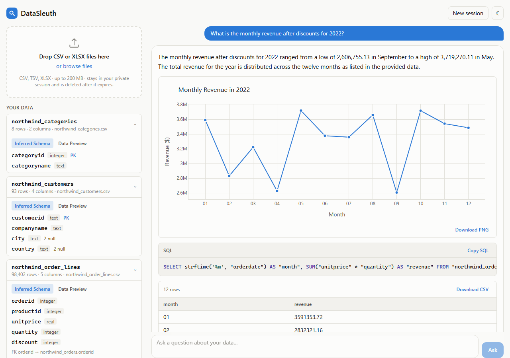

# DataSleuth

A multi-agent data analyst built with LangGraph. Upload CSV/XLSX files (or point it at a SQL database), ask a question in plain English, and get back the answer, the SQL/Pandas that produced it, an interactive chart and a step-by-step agent trace.

The agent plans the question, links the relevant schema, writes the query, validates it, runs it in a sandbox, corrects its own mistakes, and summarises the result.



## Setup

```bash
python -m venv .venv
. .venv/bin/activate                # Windows: .venv\Scripts\activate
pip install -e ".[dev,eval]"
cp .env.example .env                # add your GEMINI_API_KEY (free key: aistudio.google.com/apikey)
```

## Run

```bash
# command line
datasleuth ask --csv examples/sales.csv "Which region had the highest revenue growth in Q3?"

# web app: build the frontend once, then start the server at http://127.0.0.1:8000
(cd frontend && npm ci && npm run build)
datasleuth serve

# or with Docker
docker compose up --build
```

Other providers (`anthropic`, `openai`, `ollama`) are selected with `DATASLEUTH_LLM_PROVIDER` in `.env`.

Deploying (Render backend + Vercel frontend): see [docs/DEPLOY.md](docs/DEPLOY.md).

## Testing

```bash
pytest                                              # backend
(cd frontend && npm test)                           # frontend
(cd frontend && npm run build && npm run e2e)       # browser end-to-end
```

### Results

<!-- RESULTS:START -->
| Dataset | Questions | Execution accuracy (95% CI) | Valid SQL |
|---|---:|---|---:|
| Spider 1.0 dev (stratified by difficulty) | 50 | 86.0% [76, 94] | 100.0% |
| Northwind business database | 23 | 91.3% [78, 100] | 100.0% |

Spider 1.0 dev (stratified by difficulty): easy 91.7% · medium 90.9% · hard 75.0% · extra 75.0%

Northwind business database: easy 100.0% · medium 90.0% · hard 80.0% · unanswerable 100.0%

Full tables (ablation, error analysis, per-dataset results): [docs/RESULTS.md](docs/RESULTS.md)
<!-- RESULTS:END -->

Reproduce:

```bash
bash scripts/download_spider.sh
datasleuth eval --config configs/full.yaml --limit 50
datasleuth eval --config configs/business_full.yaml
python scripts/generate_results.py
```

## Project structure

```
datasleuth/   agent graph, nodes, sandbox, LLM layer, API, CLI
eval/         Spider and Northwind evaluation, metrics, plots, error analysis
frontend/     React app (Vite, Tailwind, Plotly)
tests/        backend tests
configs/      evaluation configs
```

MIT licensed.
